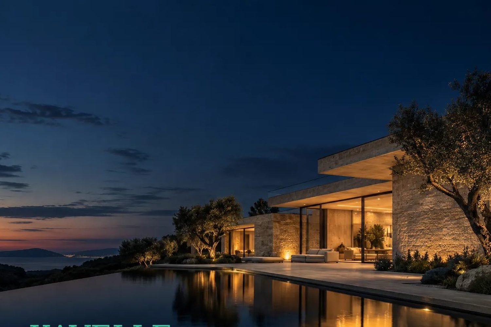

# Kavelle

A dark one-page site for an interior design or architecture studio: a full-screen project slider, project categories, the studio philosophy, services, numbers and a contact form that sends to Formgong.



Demo: https://kavelle.formgong.com

## Install

As a Hugo module:

```sh
hugo mod init example.com/site
```

```toml
# hugo.toml
[module]
  [[module.imports]]
    path = "github.com/formgong-hq/kavelle-hugo-theme"
```

Or as a git submodule:

```sh
git submodule add https://github.com/formgong-hq/kavelle-hugo-theme.git themes/kavelle
echo 'theme = "kavelle"' >> hugo.toml
```

Every text of the page lives in `data/content.json`. Copy `exampleSite/data/content.json` into your site's `data/` folder and edit it there; without it the theme uses its own copy.

Hugo 0.156.0 or newer, no npm packages and no Hugo extended needed. Posts, tags, categories and the RSS feed use the theme's list and single layouts.

## Run the example site

The folder must be named `kavelle`, the same as `theme` in `exampleSite/hugo.toml`:

```sh
git clone https://github.com/formgong-hq/kavelle-hugo-theme.git kavelle
cd kavelle/exampleSite
hugo server --themesDir ../..
```

## Contact form

The contact form posts to Formgong (free plan): put your access key in `form.access_key` in `data/content.json`. To send it anywhere else, change `params.formAction` in `hugo.toml`.

## Fonts

Italiana, DM Sans: bundled as WOFF2 files (Latin and Latin Extended), no requests to Google Fonts. SIL Open Font License 1.1, the licence texts are next to the font files.

## License

MIT
